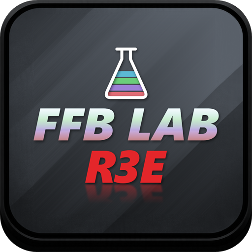
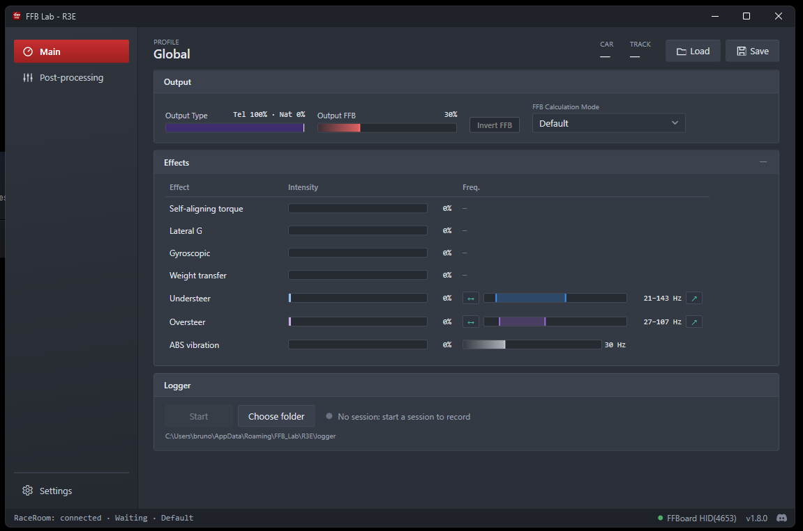
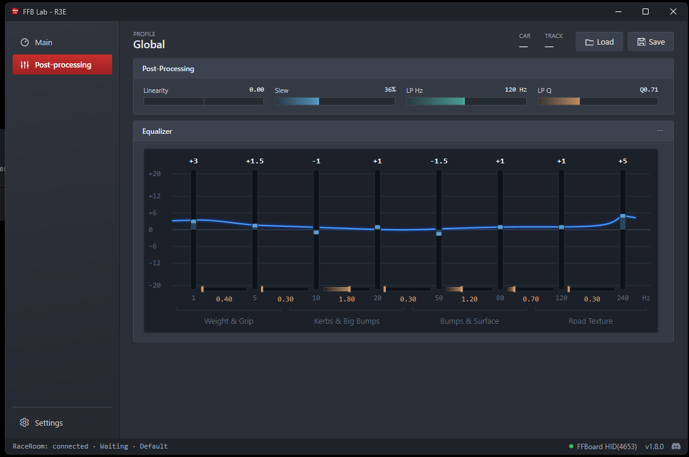
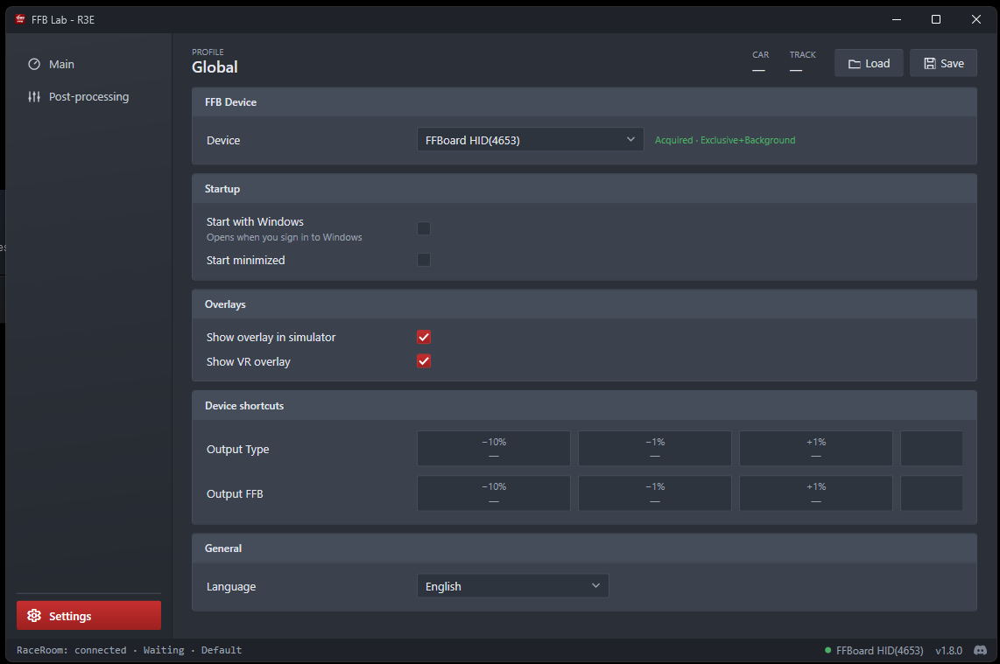
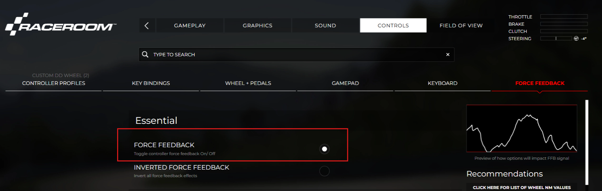
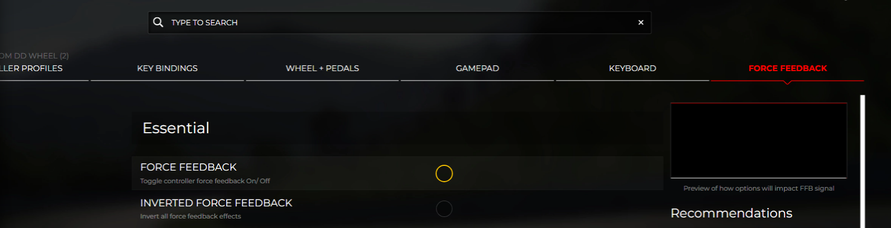

<p align="center"></p>

# FFB Lab - R3E

**Custom force feedback for RaceRoom Racing Experience, calculated by a script you can read and change.**

FFB Lab - R3E reads RaceRoom's telemetry, calculates the steering force with a calculation script,
and drives your wheel base directly. It is a single Windows program with its own window, an
on-screen overlay that sits on top of the game, and an optional VR overlay for VR drivers
(SteamVR or OpenXR).

## The interface

Every page shares the same frame: a menu on the left, a top bar with the **profile**, **car**,
**track** and the **Load / Save** buttons, and a footer with the game state, the calculation
mode, the wheel (green dot = acquired) and the version.

### Main



- **Output** — *Output Type* (the game's force vs. the force built from telemetry),
  *Output FFB* (master strength), *Invert FFB* and the *FFB Calculation Mode*.
- **Effects** — one row per effect of the calculation mode: intensity, and for the vibrations a
  frequency (single value or range, rising or falling with the effect). All start at 0 %.
- **Logger** — records the telemetry, every effect and the outputs to a CSV file, and lets you
  choose the folder.
- *Effects* can be minimised with the button on its title.

### Post-processing



- **Linearity**, **Slew**, **LP Hz** and **LP Q** — shape, rate limit and smooth the final force.
- **Equalizer** — 8 bands from 1 to 240 Hz, ±20 dB, with an adjustable width (Q) per band,
  grouped as *Weight & Grip*, *Kerbs & Big Bumps*, *Bumps & Surface* and *Road Texture*.
- These values are global: they are not part of the car profiles.

### Settings



- **FFB Device** — the wheel base to drive, and whether it was acquired.
- **Startup** — start with Windows, start minimised.
- **Overlays** — the on-screen overlay and the VR overlay, each on or off, and *Check CPU
  Affinity*, a workaround for VR performance drops (off by default).
- **Device shortcuts** — wheel buttons, hats or keys for *Output Type* and *Output FFB*.
- **General** — the language.

More detail in the [User guide](docs/user-guide.md); the overlays are described in
[Overlays](docs/overlays.md).

---

## Download

Get the latest `FFB-Lab-R3E-vX.Y.Z-win-x64.zip` from the
[**Releases**](../../releases/latest) page.

Unzip it anywhere you like and run `FFB Lab - R3E.exe`. There is nothing to install: the
application carries everything it needs inside the executable.

```
FFB-Lab-R3E-v1.9.2-win-x64\
  FFB Lab - R3E.exe       the application
  README.txt              where the scripts live and how to edit them safely
  Custom FFB Scripts\     copies of the calculation scripts (basic.ffb, default.ffb), for reference
  OpenXR\                 the OpenXR layer for the VR overlay without SteamVR (keep it next to the exe)
```

## Requirements

- Windows 10 or 11, 64-bit.
- RaceRoom Racing Experience.
- A wheel base with force feedback that Windows sees as a game controller (DirectInput).
- Optional: a headset, for the VR overlay — RaceRoom in VR through SteamVR or through the
  headset's own OpenXR runtime.

---

## Before you start

**Turn RaceRoom's own force feedback OFF** (in the game: *Controls → Force Feedback*).
FFB Lab drives the wheel itself; with the game's force feedback on, both would fight for the
same device. The first time you open FFB Lab it shows this step and asks you to accept the
disclaimer below.

| Force Feedback ON — must be changed | Force Feedback OFF — correct |
|---|---|
|  |  |

> **Safety.** Wheel bases — direct drive in particular — can produce enough torque to cause
> injury or damage. Keep your hands on the wheel when the force starts, start with a low
> *Output FFB*, and keep your wheelbase's own torque limit and emergency stop active.
> FFB Lab is experimental software, provided free of charge and "as is", without warranty
> of any kind. You use it at your own risk.

After you accept, a short guide in *Settings* walks you through three choices:
your force feedback device, starting with Windows, and the VR overlay.

---

## What it does

| | |
|---|---|
| **Force feedback from a script** | Every calculation mode is a plain-text `.ffb` file. The main mode, *Basic*, passes the game's own force through and adds understeer, oversteer and ABS effects you can tune on screen. The *Default* mode (`default.ffb`, in the package) blends the game's force with effects built from telemetry: self-aligning torque, lateral G, gyroscopic and weight transfer. → [How it works](docs/how-it-works.md) |
| **Custom calculation scripts** | Copy the script, change it, and it appears as a new mode in the list. The language is small and safe by construction. → [Custom scripts](docs/custom-scripts.md) |
| **Post-processing** | Linearity, rate limiter, low-pass filter and an 8-band equalizer, applied after the script. → [User guide](docs/user-guide.md) |
| **Profiles per car and track** | Settings are saved per car and track and come back on their own the next time you drive that combination. → [User guide](docs/user-guide.md#profiles) |
| **On-screen overlay** | A compact copy of the Main and Post-processing pages on top of the game, shown only while you are in a session. → [Overlays](docs/overlays.md) |
| **VR overlay** | The same panel inside your headset, operated with the controller laser — through SteamVR or OpenXR, chosen by itself. → [Overlays](docs/overlays.md#steamvr-overlay) |
| **Logger** | Records the telemetry, every effect of the script and the outputs to a CSV file, 500 rows per second, from the main window or either overlay. → [User guide](docs/user-guide.md#main) |
| **Car constants** | Per-car physical references (wheelbase, grip scales…) that scripts read. You can override them. → [Constants](docs/constants.md) |
| **Wheel shortcuts** | Wheel buttons, hats or keys that step *Output FFB* (and *Output Type*) by ±1 % / ±10 % while driving. |
| **5 languages** | English, Português (Brasil), Español, Français, Deutsch. |

## Documentation

- [How it works](docs/how-it-works.md) — the path from the game to your wheel.
- [User guide](docs/user-guide.md) — the pages, profiles, shortcuts and where your files are.
- [Custom scripts](docs/custom-scripts.md) — writing your own calculation mode, and what to watch out for.
- [Overlays](docs/overlays.md) — the on-screen overlay, the VR overlay (SteamVR and OpenXR) and the CPU affinity workaround.
- [Constants](docs/constants.md) — the per-car values scripts read, and how to override them.

---

## Coming from R3E Custom FFB?

FFB Lab - R3E is a separate, rewritten program. It does not read or change anything belonging to
R3E Custom FFB: its settings live in their own folder (`%APPDATA%\FFB_Lab\R3E\`). Both programs
need exclusive access to the wheel, so they cannot run at the same time — if R3E Custom FFB is
open, FFB Lab tells you and closes.

## Licence

Free for personal, non-commercial use. This is proprietary software, not open source —
see [LICENSE](LICENSE). Bundled third-party components keep their own licences:
[THIRD-PARTY-NOTICES.md](THIRD-PARTY-NOTICES.md).

## Not affiliated

This is an independent, non-commercial project. It is not affiliated with, sponsored by, or
endorsed by KW Studios, Sector3 Studios or RaceRoom Racing Experience, nor by any wheelbase
manufacturer. All trademarks are the property of their respective owners.

## Community

Questions, feedback and bug reports: [Discord](https://discord.gg/3UyyB8Aes).
