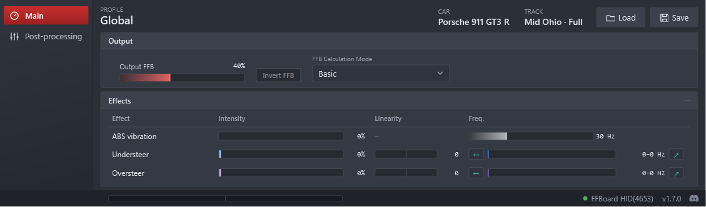
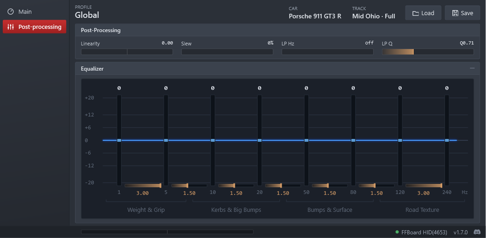
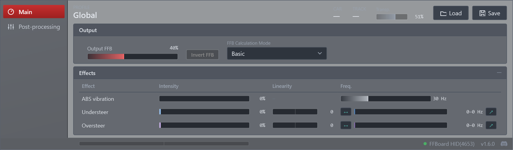

# Overlays

FFB Lab has two overlays. Both are a compact copy of the **Main** and **Post-processing**
pages, so you can adjust the force without leaving the car:

- the **on-screen overlay**, a window on top of the game;
- the **VR overlay**, the same panel inside your headset — through **SteamVR**, or through your
  headset's own **OpenXR** runtime (for example Pimax) when RaceRoom runs without SteamVR.

The overlays and the main window all show the **same values**: what you change in one appears in
the others at once. *Load* and *Save* work from the overlays too: after a successful *Save*, a
small pop-up confirms it ("Car profile saved · <track> · time" or "Profile saved · time") and
closes by itself after about 2.5 seconds, or with a click. It does not take the focus from the
game and, in the headset, does not dim the panel. The **Logger** is in the overlays too (see the
[User guide](user-guide.md#main)). The Settings page is only in the main window.

Both are switched on and off in **Settings → Overlays**.

---

## On-screen overlay

**When it shows:** with *Show overlay in simulator* on (the default), the overlay appears when
RaceRoom is in a session — on track or in the pit lane — and hides in the menus and when the game
is closed.

**Using it:**

- It stays on top of the game and does not take the focus away from it when it appears. Click it
  to use it, as with any window.
- **Moving it:** drag it by any place that is not a control — the top bar, the footer, the menu,
  the panel titles or backgrounds.
- **Transparency:** the *Transp.* bar (0–85 %) makes the backgrounds see-through. Text, bars and
  buttons always stay opaque, so they can be read on track.
- **Minimising panels:** *Effects* and *Equalizer* have a button on the right of their title.
  A minimised panel shows only its title.
- It is not in the Alt+Tab list.

Position, transparency and minimised panels are remembered (`overlay.json` in the data folder).

> If the overlay does not appear over the game, run RaceRoom in **borderless** or **windowed**
> mode: a window cannot be drawn over a game in exclusive full screen.

---

## SteamVR overlay

**Requirements:** SteamVR and a headset, with RaceRoom running **in VR through SteamVR**. When
RaceRoom runs through your headset's own OpenXR runtime, see the [OpenXR overlay](#openxr-overlay)
below. On a flat screen there is no VR panel (the log says why).

**Turning it on:** *Settings → Overlays → Show VR overlay* (off by default).

- FFB Lab **never starts SteamVR**. It connects only when SteamVR is already open **and**
  RaceRoom is in VR with your car in the garage or on track — grid, formation and countdown
  included.
- The panel shows at those moments. In the menus, in pause and in replays it hides **and FFB
  Lab disconnects from SteamVR**, sending it nothing: closing SteamVR after leaving the game
  keeps it closed.
- Turning the setting off disconnects from SteamVR immediately.

**Using it with the controllers:**

- Point a controller's laser at the panel and pull the trigger to click, or hold it to drag a
  bar or an equalizer band.
- Lists open as a choice inside the headset; text boxes (a profile name, for example) use the
  SteamVR keyboard.
- **Moving the panel:** point at any place that is not a control, hold, and move the controller.
- **Anchoring the panel:** the pin button at the bottom right of the panel. Anchored, pointing at
  an empty area and holding no longer moves the panel; bars, equalizer, menu and buttons work as
  usual, and the controller's scroll still brings it closer or pushes it away. Click the pin again
  to release it.

**The headset row** at the top of the panel:

| Button | What it does |
|---|---|
| **Dist. − / +** | Brings the panel closer or pushes it away, 5 cm at a time. The controller's scroll does the same. |
| **Curve − / +** | Curves the panel around you, step by step (0 = flat). |
| **Face me** | Turns the panel towards your head without moving it. A curved panel only turns horizontally. |
| **Reset** | Puts the panel back in front of the headset, level. |

The first time, the panel appears in front of the driver's head. The VR panel has its own transparency and minimised panels (the first time, it takes those of the
on-screen overlay). Its position, curve and anchor are remembered (`vr-overlay.json` in the data folder).

---

## OpenXR overlay

The same panel, for when RaceRoom runs in VR **through your headset's own OpenXR runtime**
instead of SteamVR (for example the Pimax runtime). FFB Lab picks the mode by itself: the
OpenXR overlay when the game runs through OpenXR, the SteamVR overlay when it runs through
SteamVR. The panel, its pages and its buttons are the same in both.

**How it gets into the game:** the package has an `OpenXR` folder next to the executable. While
*Show VR overlay* is on, FFB Lab registers it with Windows as an OpenXR layer for your user
account (nothing to install, no administrator rights), and removes that registration when you
turn the setting off. It takes effect the next time RaceRoom starts. The layer works **only
inside RaceRoom**: in any other OpenXR application it does nothing at all.

**When it shows:** the same moments as the SteamVR overlay — in VR with your car in the garage
or on track, hidden in the menus, in pause and in replays.

**Using it with the controllers:**

- Point a controller's laser at the panel and pull the trigger to click, or hold it to drag a
  bar or an equalizer band.
- **Moving the panel:** point at any place that is not a control, hold the trigger, and move the
  controller. The joystick (up / down) brings it closer or pushes it away, 5 cm at a time.
- **Anchoring, Dist., Face me and Reset** work as in the SteamVR overlay.
- **Curve** goes from 0 (flat) to 0.40.
- There is no keyboard in the headset, and the Logger's *Choose folder* is only available in the
  main window.

**Where the panel appears:**

- The first time, centred in front of you, a little above your eyes, so it does not cover the
  track. After that, where you left it — leaving the car, going back to the menu or restarting
  the game does not move it.
- **Recentring your headset** brings the panel back to the centre, a little above your eyes.
  **Reset** does the same.

Its position and curve are remembered in `vr-overlay.json`, apart from the SteamVR ones.

---

## Check CPU Affinity (VR performance workaround)

*Settings → Overlays → Check CPU Affinity* — **off by default.**

Some PCs show a drop in VR: RaceRoom stops holding the headset's frame rate (for example
80–90 fps instead of a steady 90) with CPU and GPU far from their limits. Switching the game's
CPU affinity to another set of cores and back fixes it until the next track load.

With this setting on and the game in VR, FFB Lab checks the game each time you go **from the
menu to the pit lane** or **from the pit lane back to the menu**. If one of the game's threads is
busy-waiting on a core, it switches the affinity; otherwise it does nothing. It never acts on
track or during a race.

It is a workaround: it is not guaranteed to help, and it has **only been tested on Intel
CPUs**. Turn it on only if you have the problem; leave it off if VR runs fine.
